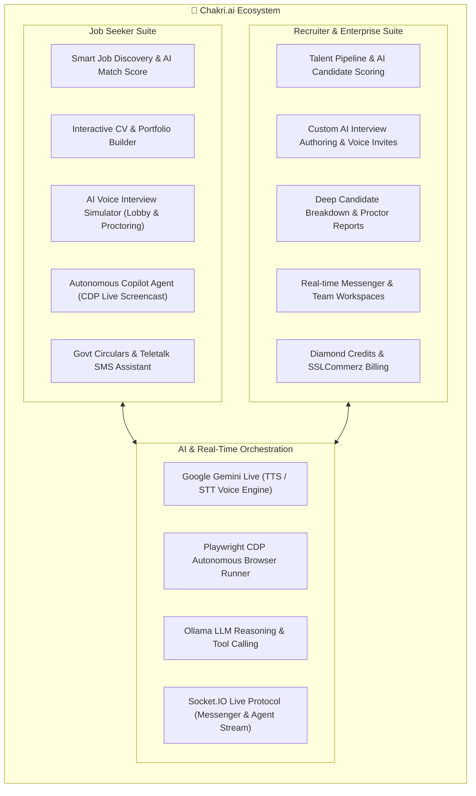

# 💼 Chakri.ai — Next-Gen AI Recruitment & Career Intelligence Platform
### *Prototype Submission for AI Builder Cup 2026 | Hack2Skill*

<p align="center">
  
  
  
  
  
  
  
</p>

---

## 📌 Executive Summary

**Chakri.ai** (চাকরি ডট এআই) is an end-to-end autonomous recruitment and career acceleration platform architected to modernize the talent ecosystem in Bangladesh and emerging markets.

Traditional hiring platforms operate as static digital bulletin boards—flooded with irrelevant applications, manual screening bottlenecks, and zero personalization. **Chakri.ai** transforms this paradigm into an **intelligent, agentic marketplace**:
1. **Autonomous AI Agents** navigate the web via headless Chromium and CDP screencasts to discover, auto-apply, and manage application pipelines.
2. **Multimodal Voice AI Interviewers** conduct lifelike, proctored voice interviews using **Google Gemini Live**, generating actionable analytics for recruiters and candidates.
3. **Contextual Match Engine** computes real-time alignment scores between applicant credentials and job requisites, highlighting concrete skill gaps.
4. **Localized Government Circular Engine** unlocks structured accessibility for Bangladesh public service circulars, complete with automated Teletalk SMS guides and admit card alerts.

---

## 🚀 Key Innovations & Core Modules



### 1. 🎙️ Multimodal AI Voice Interview Room
- **Voice-to-Voice Real-Time Dialogue:** Powered by Google's cutting-edge Gemini Live runtime (`gemini-3.1-flash-live-preview` for expressive speech synthesis and `gemini-3.5-transcribe-live` for low-latency speech transcription).
- **Interactive Lobby & Device Check:** Video preview, audio testing, and explicit consent before room entry.
- **Intelligent Proctoring:** Integrated automated supervision monitoring face visibility, mobile phone usage, window defocus, and tab switching with warning ceilings.
- **Comprehensive Candidate Report:** Instant post-interview scorecard assessing technical depth, communication clarity, domain knowledge, and proctoring audit trails.

### 2. 🤖 Autonomous Chakri Copilot Agent
- **Browser Automation via CDP:** Operates an isolated Playwright Chromium browser instance, streaming interactive frames back to the client over WebSockets.
- **Agentic Tool Calling:** Seamlessly searches jobs, verifies requirements, fills out external application fields, and requests human confirmation at critical action milestones.

### 3. 🎯 Deep AI Semantic Job Matching
- Instant vector and rule-based matching score generated across all public and private listings.
- Transparent match breakdown revealing matched proficiencies, missing qualifications, and concrete career advice.

### 4. 🇧🇩 Localized Bangladesh Government Circular Hub
- Dedicated intelligence hub parsing Bangladesh official gazettes and public service job circulars.
- Automatic breakdown of grade levels, vacancy numbers, educational requisites, and step-by-step Teletalk SMS instructions.

### 5. ⚡ Enterprise Real-Time Messenger
- Dual-role messaging system connecting job seekers with verified employers.
- Real-time typing indicators, read status, presence heartbeats, and interactive cards for interview invitations.

---

## 🏗️ System Architecture

```mermaid
flowchart LR
    subgraph ClientLayer["Frontend — Next.js 16 & React 19"]
        APP["App Router (PPR & RSC)"]
        UI["Tailwind CSS v4 & Lucide UI"]
        WS_CLIENT["Socket.IO Client (Streams & Events)"]
    end

    subgraph APILayer["Backend — NestJS 12"]
        REST["Express REST Core (/api/*)"]
        GATEWAY["Socket.IO Gateways (/messages, /agent, /interviews)"]
        GUARDS["Role Guards & Redis Rate Limiter"]
    end

    subgraph Brains["Intelligence & External Services"]
        GEMINI["Google Gemini Live API"]
        OLLAMA["Ollama LLM Engine"]
        PLAYWRIGHT["Playwright Chromium Engine"]
        PG[("PostgreSQL via Prisma 7")]
        REDIS[("Redis In-Memory Cache")]
        R2["Cloudflare R2 (S3 Storage)"]
        MAIL["Resend & WhatsApp OTP"]
    end

    ClientLayer <-->|"REST API & WebSockets"| APILayer
    APILayer <--> Brains
```



---

## 🛠️ Technology Stack

| Layer | Technologies & Frameworks | Description |
| :--- | :--- | :--- |
| **Frontend Framework** | **Next.js 16** (React 19, TypeScript) | Server Components (RSC), Partial Prerendering (PPR), App Router |
| **Styling & UI** | **Tailwind CSS v4**, Radix UI primitives, Lucide Icons | Ultra-fast utility styling, responsive dark/light theme |
| **Backend Framework** | **NestJS 12** (TypeScript, Node.js 24+) | Modular enterprise-grade architecture with Dependency Injection |
| **Database & ORM** | **PostgreSQL 16+**, **Prisma 7** (`@prisma/adapter-pg`) | Strongly typed data access layer, migrations, and relational modeling |
| **Real-Time Layer** | **Socket.IO** (`@nestjs/platform-socket.io`) | Dual-channel WebSockets for messaging, notifications, and agent frames |
| **Voice & Multimodal AI**| **Google Gemini Live** (`@google/genai`) | `gemini-3.1-flash-live-preview` (TTS) & `gemini-3.5-transcribe-live` (STT) |
| **Local LLM Engine** | **Ollama** (`ollama`) | Tool calling, contextual resume parsing, and agentic reasoning |
| **Browser Automation** | **Playwright** (Chromium Engine) | Headless browser execution with Chrome DevTools Protocol (CDP) |
| **In-Memory Cache** | **Redis** (`ioredis`) | Fast session management, sliding-window rate limiting, token caching |
| **Storage & Media** | **Cloudflare R2** (`@aws-sdk/client-s3`) | S3-compatible high-performance storage for CVs and media |
| **Authentication** | JWT, bcrypt, Google OAuth 2.0, LinkedIn OAuth | Hardened multi-role access control (Seeker, Recruiter, Admin) |
| **Testing & Tooling** | Vitest 4, oxlint, Prettier | Lightning-fast unit testing, end-to-end testing, and static analysis |

---

## 📂 Repository Structure

```
.
├── backend/                  # NestJS 12 Enterprise Backend Service
│   ├── prisma/               # Prisma 7 schemas, migrations, and seed scripts
│   ├── src/
│   │   ├── agent/            # Chakri AI Autonomous Agent & Playwright CDP runner
│   │   ├── auth/             # Multi-role authentication & OAuth providers
│   │   ├── chat/             # Real-time messenger & AI chat logic
│   │   ├── common/           # Custom guards, decorators, filters, and interceptors
│   │   ├── govt-jobs/        # Bangladesh government circular parsing & guides
│   │   ├── interviews/       # Gemini Live AI voice interview service & proctoring
│   │   ├── jobs/             # Job postings, applications, and AI match scoring
│   │   ├── onboarding/       # Seeker & recruiter role onboarding workflows
│   │   ├── prisma/           # Database module & Prisma connection lifecycle
│   │   ├── redis/            # Redis cache client & rate-limiting services
│   │   └── user/             # User profile, skills, and credential management
│   ├── package.json
│   └── tsconfig.json
│
├── frontend/                 # Next.js 16 Web Application
│   ├── public/               # Static assets, branding, and images
│   ├── src/
│   │   ├── actions/          # Next.js Server Actions for secure mutations
│   │   ├── app/              # App Router pages (Landing, Auth, Dashboards, Interview)
│   │   │   ├── auth/         # Login, signup, password reset, and waitlist
│   │   │   ├── dashboard/    # Seeker and Recruiter role-based control panels
│   │   │   ├── interview/    # AI Interview voice lobby, live proctored room & reports
│   │   │   └── jobs/         # Public job board, filters, and job detail views
│   │   ├── components/       # Reusable UI component library (Modals, Cards, Navbars)
│   │   ├── hooks/            # Custom React hooks (Socket, Audio, Proctoring)
│   │   └── lib/              # Client utilities, API fetch bridge, and helpers
│   ├── package.json
│   └── next.config.ts
│
├── .gitignore                # Global root gitignore protecting secrets & build artifacts
└── README.md                 # Master project documentation & submission manifesto
```

---

## ⚙️ Quick Start & Local Setup

### Prerequisites
- **Node.js**: `v24.x` or higher
- **PostgreSQL**: `v15+` (Local or cloud-hosted)
- **Redis**: `v7+` (Local or cloud-hosted)
- **Ollama**: Local instance running on port 11434 (Optional for local LLM inference)

> **Quick Docker Tip:** Run PostgreSQL and Redis in seconds:
> ```bash
> # Start PostgreSQL
> docker run --name chakri-postgres -e POSTGRES_PASSWORD=postgres -e POSTGRES_DB=chakri_ai -p 5432:5432 -d postgres:16-alpine
>
> # Start Redis
> docker run --name chakri-redis -p 6379:6379 -d redis:7-alpine
> ```

---

### Step 1: Backend Setup

```bash
cd backend

# 1. Install dependencies (Playwright Chromium is installed automatically via postinstall)
npm install

# 2. Configure environment variables
cp .env.example .env
# Edit .env with your PostgreSQL, Redis, and API credentials

# 3. Apply Prisma migrations and generate client
npx prisma migrate deploy --config prisma7.config.ts
npx prisma generate --config prisma7.config.ts

# 4. (Optional) Seed initial administrator data
npx prisma db seed --config prisma7.config.ts

# 5. Start development server
npm run start:dev
```
*The backend API will start at `http://localhost:8000`.*

---

### Step 2: Frontend Setup

```bash
cd ../frontend

# 1. Install dependencies
npm install

# 2. Configure environment variables
cp .env.example .env.local
# Set NEXT_PUBLIC_API_URL=http://localhost:8000

# 3. Start development server
npm run dev
```
*The web portal will be accessible at `http://localhost:3000`.*

---

## 🏆 Alignment with AI Builder Cup 2026 Criteria

| Evaluation Dimension | Chakri.ai Implementation |
| :--- | :--- |
| **Google AI Tech Integration** | Leverages **Google Gemini Live API** for real-time natural conversational audio synthesis and bidirectional live transcription during interviews. |
| **Innovation & Originality** | Combines **autonomous browser agents (CDP)** with real-time video/voice proctoring to pioneer the world's first interactive career assistant in Bangladesh. |
| **Technical Excellence & Scale** | Modern modular architecture utilizing **Next.js 16**, **NestJS 12**, **Prisma 7**, **PostgreSQL**, and **Redis** with zero latency bottlenecks. |
| **Societal & Regional Impact** | Solves youth employment friction, democratizes career mentorship, and simplifies access to government job circulars for millions of candidates. |
| **Product Completeness** | Fully functional prototype with user onboarding, recruiter talent pipeline, real-time messaging, AI mock interviews, and automated evaluation reports. |

---

## 👥 Team & Submission Information

- **Event:** AI Builder Cup 2026 (Hack2Skill)
- **Stage:** Prototype Evaluation
- **Team:** Chakri AI Tech Lab
- **Repository:** [https://github.com/chakriaitechlab/Prototype](https://github.com/chakriaitechlab/Prototype)

---

<p align="center">
  <b>Built with ❤️ by Chakri AI Tech Lab for the AI Builder Cup 2026</b>
</p>
