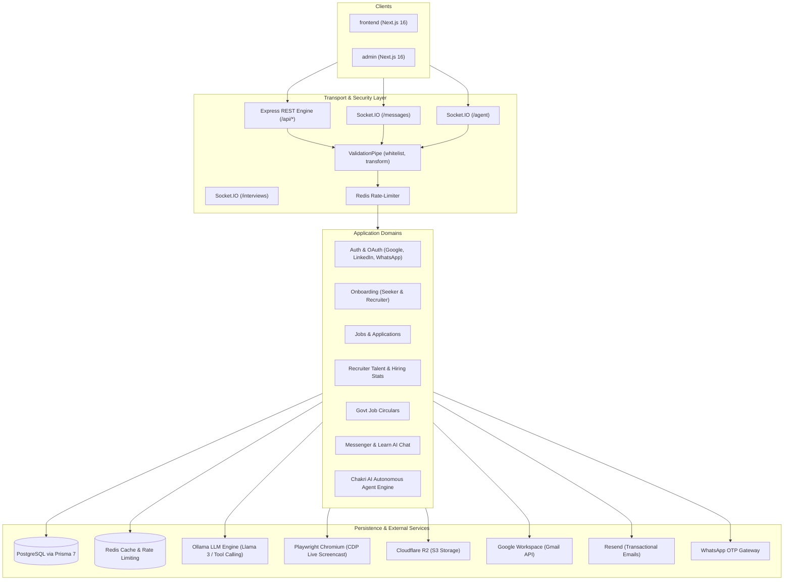

# Chakri.ai — Backend API

<p align="center">
  
  
  
  
  
  
  
  
</p>

The enterprise REST and real-time WebSocket API powering [Chakri.ai](https://chakriai.com) — a next-generation recruitment and career platform in Bangladesh. Built with NestJS 12, Prisma 7, PostgreSQL, Redis, and Playwright, it handles multi-role authentication, interactive onboarding, job matching, candidate talent management, government circulars, real-time messaging, AI learning chat, and an autonomous AI agent with live browser interaction.

---

## Architecture at a glance



---

## Tech stack

| Category | Technology | Purpose |
|---|---|---|
| **Core Framework** | NestJS 12 (TypeScript 6, ES modules) | Modular enterprise backend architecture |
| **Database & ORM** | PostgreSQL 16+ via Prisma 7 (`@prisma/adapter-pg`) | Type-safe schema, migrations, relational queries |
| **In-Memory Store** | Redis (`ioredis`) | Fast session cache, token blacklists, sliding-window rate limiting |
| **Real-Time** | Socket.IO (`@nestjs/platform-socket.io`) | Low-latency chat and live agent screencast streaming |
| **AI Runtime** | Ollama (`ollama`) | Local/cloud LLM inference, tool calling, and web search |
| **Interview Voice** | Gemini Live (`@google/genai`) | `gemini-3.1-flash-live-preview` text-to-speech and `gemini-3.5-transcribe-live` live speech-to-text |
| **Browser Engine** | Playwright (Chromium) | Autonomous web navigation, clicking, typing, and CDP screencast |
| **Object Storage** | Cloudflare R2 (`@aws-sdk/client-s3`) | S3-compatible asset and CV storage |
| **Communications** | Resend & WhatsApp API Gateway | Transactional email verification and instant WhatsApp OTPs |
| **Security & Auth** | JWT (`@nestjs/jwt`), bcrypt, AES-256-GCM | Encrypted OAuth connectors, hardened auth flows |
| **Validation** | `class-validator`, `class-transformer` | Strict DTO payload whitelisting and auto-transformation |
| **Testing & Quality** | Vitest 4, oxlint, Prettier | Blazing-fast unit tests, E2E tests, and static linting |

---

## Getting started

### Prerequisites

- **Node.js**: `v24.x` or higher
- **PostgreSQL**: `v15+` (local or hosted)
- **Redis**: `v7+` (local or hosted)
- **Ollama**: Local instance or remote endpoint (`http://localhost:11434`)

> **Tip (Instant Local Services via Docker):**  
> If you don't have PostgreSQL and Redis installed locally, you can start both in seconds:
> ```bash
> # Start PostgreSQL
> docker run --name chakri-postgres -e POSTGRES_PASSWORD=postgres -e POSTGRES_DB=chakri_ai -p 5432:5432 -d postgres:16-alpine
>
> # Start Redis
> docker run --name chakri-redis -p 6379:6379 -d redis:7-alpine
> ```

---

### Installation & Setup

1. **Clone and install dependencies:**
   ```bash
   git clone https://github.com/chakriaitechlab/chakri-ai-backend.git
   cd chakri-ai-backend
   npm install
   ```
   > *Note:* The `postinstall` script automatically downloads the exact Chromium build required by Playwright for the autonomous agent.

2. **Configure environment variables:**
   ```bash
   cp .env.example .env
   ```
   Generate the 32-byte encryption key for connector credentials:
   ```bash
   openssl rand -base64 32
   ```
   Paste the generated string into `CONNECTOR_ENCRYPTION_KEY` in `.env` along with your database and service credentials.

3. **Run Prisma 7 database migrations & client generation:**
   ```bash
   npx prisma migrate deploy --config prisma7.config.ts
   npx prisma generate --config prisma7.config.ts
   ```

4. **Seed initial admin credentials (optional):**
   ```bash
   npx prisma db seed --config prisma7.config.ts
   ```
   *(Uses `ADMIN_EMAIL` and `ADMIN_PASSWORD` from `.env`)*

5. **Start the API:**
   ```bash
   # Start with hot-reload watch mode (recommended for development)
   npm run start:dev

   # Or run without file watcher
   npm run dev
   ```

The API will boot and listen on `http://localhost:8000` (WebSocket gateways accessible at `ws://localhost:8000`).

---

## Available scripts

| Command | Description |
|---|---|
| `npm run start:dev` | Start NestJS in development mode with active watch-mode file reload |
| `npm run dev` | Start NestJS directly without watch mode |
| `npm run build` | Compile TypeScript into production-ready ES modules under `dist/` |
| `npm run start:prod` | Execute the compiled production bundle (`node dist/src/main`) |
| `npm run lint` | Run ultra-fast type-aware linting with `oxlint` across `src/` and `test/` |
| `npm run format` | Enforce code formatting standard via Prettier |
| `npm test` | Run unit tests using Vitest |
| `npm run test:watch` | Run Vitest in interactive watch mode |
| `npm run test:cov` | Generate full unit test code-coverage report (`@vitest/coverage-v8`) |
| `npm run test:e2e` | Run end-to-end integration tests (`vitest.config.e2e.ts`) |
| `npm run deploy` | Automated zero-downtime deployment script for Render |

---

## Project structure & architecture

The project adheres to a clean, domain-driven structure under `src/`:

```
src/
├── main.ts                         # Bootstrap entrypoint, CORS, global validation pipe
├── app.module.ts                   # Root application module orchestrating domain groups
│
├── infrastructure/                 # Shared global plumbing modules (@Global())
│   ├── ai/                         # Ollama LLM provider (chat, JSON output, streaming, web search)
│   ├── speech/                     # Gemini Live text-to-speech and live speech-to-text for AI interviews
│   ├── browser/                    # Playwright Chromium manager with SSRF & private IP blocking
│   ├── prisma/                     # Prisma 7 PostgreSQL database client
│   ├── redis/                      # Redis connection and distributed caching
│   ├── rate-limit/                 # Redis-backed sliding-window rate limiters
│   ├── storage/                    # Cloudflare R2 / S3 client for media and CV documents
│   ├── email/                      # Resend integration and HTML email templates
│   ├── sslcommerz/                 # SSLCommerz payment gateway (checkout session, payment validation)
│   └── whatsapp/                   # WhatsApp Gateway for rapid OTP delivery
│
├── common/                         # Domain features accessible across user roles
│   ├── auth/                       # Credentials, Google/LinkedIn OAuth, WhatsApp OTP, JWT
│   ├── onboarding/                 # Multi-step profile setup for seekers and recruiters
│   ├── settings/                   # Account management, active sessions, security preferences
│   ├── notifications/              # In-app notifications
│   ├── messages/                   # Real-time direct chat (REST + Socket.IO `/messages`)
│   ├── interviews/                 # AI voice interviews: sessions, Q&A flow, reports (REST + Socket.IO `/interviews`)
│   ├── jobs/                       # Public job search, company listings, and details
│   ├── support/                    # User support ticket & inquiry processing
│   ├── waitlist/                   # Pre-launch waitlist sign-ups while public signup is closed
│   ├── payments/                   # Plan purchases through SSLCommerz (card, bKash, Nagad, Rocket)
│   ├── diamonds/                   # Diamond wallet: plans catalog, monthly refill, activity log
│   └── agent/                      # Chakri AI Autonomous Agent runtime & WebSocket gateway
│
├── seeker/                         # Job Seeker exclusive services
│   ├── jobs/                       # Job applications, tracking, bookmarked jobs, and AI match scores
│   ├── cv/                         # Dynamic CV builder, structure, and export data
│   ├── profile/                    # Public and private seeker profile management
│   ├── govt-jobs/                  # Bangladesh government job circulars & notifications
│   └── learn/                      # AI learning assistant & interactive interview prep
│
├── recruiter/                      # Recruiter & Employer exclusive services
│   ├── hire/                       # Job posting creation, updating, and applicant tracking
│   ├── talent/                     # Candidate search engine, analytics, and recruiter stats
│   ├── favorites/                  # Shortlisted and bookmarked talent
│   └── company/                    # Company profile, branding, and team settings
│
└── admin/                          # Administrative moderation and system controls
```

### Architectural conventions

1. **Feature Encapsulation:** Every domain feature is encapsulated in exactly one `<feature>.module.ts` and one `<feature>.controller.ts`.
2. **Strict Validation in DTOs:** All format, sanitization, trimming, casing, and enum validations live in DTOs using `class-validator` and `class-transformer`. Services never duplicate validation logic.
3. **Configuration Isolation:** Secrets and tunable parameters come exclusively through `ConfigService` with full type guards. Stable invariants are kept as `UPPER_SNAKE_CASE` constants at module headers.
4. **Resilient Rate Limiting:** All sensitive mutation points (auth, OTP, file uploads, agent runs) are protected by Redis sliding-window limiters.

---

## API & WebSocket overview

All REST endpoints are uniformly prefixed with `/api`.

### REST Endpoints

| Prefix | Domain | Description |
|---|---|---|
| `/api/auth` | Authentication | Sign-up, sign-in, OAuth callbacks, WhatsApp OTP, token refresh, password reset, public `signup-status` |
| `/api/onboarding` | Onboarding | Step-by-step role selection, username, contact info, and initial profile |
| `/api/settings` | Settings | Account details, password rotation, login sessions, notification preferences |
| `/api/notifications` | Notifications | User alerts, unread counts, mark-as-read endpoints |
| `/api/messages` | Messaging | Conversations list, chat histories, direct messages; messages carry a `kind` (`TEXT`, `INTERVIEW_INVITE`, `APPLICATION_REJECTED`, `INTERVIEW_COMPLETED`) and `metadata` for hiring updates |
| `/api/jobs` | Public Jobs | Searchable job listings, filtering by location/salary, job detail views (company includes `isVerified`, set by admins); seekers apply with `POST /:id/apply` (multipart: `cvSource` `profile` or `upload` + optional `file`) and check status with `GET /:id/application`; seekers read match scores with `POST /match-scores` and `GET /:id/match-explanation` (`PENDING` until a background worker scores the seeker's profile/CV against the job with AI, falling back to skill overlap; a score is recalculated when the CV or job changes, or when a match-relevant profile field changes (headline, about, location, availability, job preferences, skills, experience, education, projects, certifications, achievements, languages) — name and social links do not; after a profile change only the jobs the seeker opens are re-scored) |
| `/api/govt-jobs/v1` | Government Jobs | Public Bangladesh government job circulars; `POST /:id/details` (circular data from the worker) needs the `X-Worker-Key` header |
| `/api/interviews` | AI Interview | Seeker interview list and detail, `POST /:id/start`, `/answer` (server picks the next question), `/violations` (3 warnings end it), `/complete`, `/reset` (temporary pre-launch retake: deletes answers and report, new 7-day invite), `/speech` (Gemini TTS NDJSON stream; kinds `preview`, `greeting`, `question`, `transition`, `silence`, `skip`, `closing`), `/socket-token`; `GET /:id/report` for the seeker or the job's recruiter |
| `/api/profile` | Seeker Profile | Seeker career history, skills, education, and portfolio |
| `/api/cv` | CV Builder | CV sections, templates, and structured resume data |
| `/api/learn/chats` | AI Learning | Interactive learning conversations with streaming AI feedback |
| `/api/hire` | Job Posting | Recruiter job authoring, status toggling, applicant metrics; manual applicant review with `GET /jobs/:id/applicants` and `POST /jobs/:id/applicants/:applicationId/invite` (AI interview invite, expires in 7 days) or `/reject`, each sending a message to the seeker |
| `/api/recruiter` | Talent Search | Recruiter hiring metrics, applicant candidate profiles, resume access |
| `/api/favorites` | Saved Talent | Recruiter talent bookmarks and shortlists |
| `/api/company` | Company Profile | Employer profile information, office locations, branding |
| `/api/upload` | Media & Storage | Authenticated Cloudflare R2 uploads (resumes, logos, avatars) |
| `/api/support` | Support | Public contact form inquiries sent to support desk |
| `/api/waitlist` | Waitlist | Public waitlist sign-up (name, email, optional occupation), rate-limited by IP |
| `/api/payments` | Payments | Seeker/recruiter plan purchase via SSLCommerz: `POST /checkout` (`{ planId }` → `gatewayUrl`), `GET /history`; public SSLCommerz callbacks `POST /success`, `/fail`, `/cancel` (redirect to the frontend credits page with `?payment=`) and `POST /ipn`. A payment is marked paid only after the SSLCommerz validation API confirms its amount and currency; a paid payment activates the plan for 30 days and adds its diamonds (once per transaction) |
| `/api/diamonds` | Diamonds | Public `GET /plans?role=seeker\|recruiter` (plan name, price, monthly diamonds); seeker/recruiter `GET /wallet` (balance, plan, plan expiry, next refill) and `GET /usage` (last 50 activity rows). A wallet opens with 50 free diamonds on first access; on each 30-day refill the balance resets to the plan's monthly diamonds and an expired plan falls back to Free. No feature spends diamonds yet |
| `/api/agent` | Autonomous Agent | Agent chat sessions, Gmail OAuth connector management, WebSocket tokens |
| `/api/admin` | Admin Console | System metrics, user moderation, circular scrapers, platform oversight |

### Real-Time WebSocket Gateways

| Namespace | Transport | Purpose |
|---|---|---|
| `/messages` | Socket.IO | Instant seeker ↔ recruiter messaging, typing indicators, read receipts |
| `/agent` | Socket.IO | Real-time agent streaming, step progress, live browser CDP screencast frames |
| `/interviews` | Socket.IO | AI interview live speech-to-text: browser streams 16-bit PCM (`stt:start`, `stt:audio`, `stt:stop`), server sends `stt:interim` / `stt:final`; audio sent before the provider connects is buffered, and a dropped provider connection reconnects up to twice per answer |

---

## Chakri AI autonomous agent

The agent module (`src/common/agent`) provides an autonomous AI assistant capable of multi-step problem solving with human-in-the-loop safety:

- **Loop Architecture:** Streams responses chunk-by-chunk, inspects intent, calls tools iteratively, and pauses for user feedback.
- **Tool Suite:**
  - `web_search` & `web_fetch`: Internet-wide information retrieval.
  - `navigate`, `click`, `type`, `scroll`, `go_back`: Playwright-driven human-like browser actions.
  - `gmail_search`, `gmail_read`, `gmail_draft`, `gmail_send`, `gmail_modify`: Full Gmail integration.
  - `list_my_jobs`, `job_detail`, `search_candidates`, `hiring_stats`: Recruiter-exclusive platform tools.
  - `ask_user`: Interactive clarification and multi-choice options.
- **Live Screencast:** Streams compressed JPEG viewport frames directly from Chromium DevTools Protocol (CDP) with a visible animated cursor overlay.
- **Safety & Sandboxing:**
  - Risky actions (sending emails, moving to trash) require interactive confirmation cards.
  - Private IPv4/IPv6 ranges and loopback interfaces are blocked to prevent SSRF.
  - Untrusted content isolation: Instructions in external pages/emails are strictly ignored.
  - Gmail OAuth tokens are encrypted at rest with **AES-256-GCM**.

*For full details on agent capabilities and rules, see [docs/agent-features.md](../docs/agent-features.md).*

---

## Environment configuration

| Variable | Type | Description |
|---|---|---|
| `PORT` | `number` | HTTP listening port (default: `8000`) |
| `NODE_ENV` | `string` | Environment identifier (`development` \| `production`) |
| `CORS_ORIGINS` | `string` | Comma-separated list of allowed web origins |
| `DATABASE_URL` | `string` | PostgreSQL connection string with Prisma connection pool parameters |
| `REDIS_URL` | `string` | Redis connection URL (`rediss://` for TLS-enabled clusters) |
| `JWT_SECRET` | `string` | Cryptographic secret for signing user access tokens |
| `JWT_EXPIRES_IN` | `string` | Access token lifespan (e.g. `7d`) |
| `ADMIN_EMAIL` / `ADMIN_PASSWORD` | `string` | Seed account credentials for `npx prisma db seed` |
| `GOOGLE_CLIENT_ID` / `GOOGLE_CLIENT_SECRET` | `string` | Google Cloud OAuth credentials for sign-in and Gmail connector |
| `GMAIL_REDIRECT_URI` | `string` | OAuth callback URI (must match Google Cloud Console registration) |
| `CONNECTOR_ENCRYPTION_KEY` | `string` | 32-byte base64 key used for AES-256-GCM token encryption |
| `LINKEDIN_CLIENT_ID` / `LINKEDIN_CLIENT_SECRET` | `string` | LinkedIn OAuth credentials for social sign-in |
| `RESEND_API_KEY` / `RESEND_FROM` | `string` | Resend API token and verified sender email address |
| `SUPPORT_EMAIL` | `string` | Inbox receiving inbound `/api/support` messages |
| `WA_GATEWAY_URL` / `WA_GATEWAY_KEY` | `string` | WhatsApp OTP Gateway URL and authentication secret |
| `SSLCOMMERZ_STORE_ID` / `SSLCOMMERZ_STORE_PASSWORD` | `string` | SSLCommerz store credentials; when unset, payment routes return 503 |
| `SSLCOMMERZ_IS_LIVE` | `boolean` | `false` (default) uses the SSLCommerz sandbox, `true` the live gateway |
| `API_PUBLIC_URL` | `string` | Public base URL of this API, used for SSLCommerz callback URLs (default `http://localhost:8000`) |
| `FRONTEND_URL` | `string` | Frontend base URL that payment callbacks redirect to (default `http://localhost:3000`) |
| `GOVT_JOBS_WORKER_KEY` | `string` | Shared key the govt-jobs worker sends as `X-Worker-Key`; when unset, `POST /api/govt-jobs/v1/:id/details` rejects every request |
| `R2_ENDPOINT` / `R2_BUCKET` | `string` | Cloudflare R2 S3-compatible endpoint and target bucket |
| `R2_ACCESS_KEY_ID` / `R2_SECRET_ACCESS_KEY` | `string` | Cloudflare R2 API credentials |
| `R2_PUBLIC_BASE_URL` | `string` | Public CDN URL for serving uploaded assets |
| `OLLAMA_BASE_URL` / `OLLAMA_MODEL` | `string` | Ollama service endpoint and active model tag |
| `OLLAMA_API_KEY` | `string` | API key for hosted Ollama (e.g. `https://ollama.com`); leave empty for a local server |
| `GEMINI_API_KEY` | `string` | Gemini Live API key for AI interview voice (text-to-speech and live speech-to-text) |
| `PLAYWRIGHT_BROWSERS_PATH` | `string` | Set to `0` on Render so `postinstall` puts Chromium inside `node_modules` (the build cache is dropped at runtime); leave unset locally |
| `ENABLED_SIGNUP` | `boolean` | Public signup gate (default `true`). `false` blocks new accounts (email, Google, LinkedIn) and the frontend shows the waitlist instead |
| `DEVICE_SIGNUP_MAX` / `DEVICE_SIGNUP_WINDOW_DAYS` | `number` | Device fingerprint rate limiting for fraud prevention |

---

## Production deployment

The backend is built for zero-downtime deployment on platforms like **Render**, **Railway**, or **AWS ECS/Kubernetes**:

1. **Build Step:**
   ```bash
   npm install && npm run build
   ```
2. **Database Migrations:** Run against the production database during deployment:
   ```bash
   npx prisma migrate deploy --config prisma7.config.ts
   ```
3. **Chromium on Render:** set `PLAYWRIGHT_BROWSERS_PATH=0` and redeploy with *Clear build cache & deploy*; otherwise Chromium is downloaded to `/opt/render/.cache`, which is not kept after the build, and the agent browser fails to launch.
4. **Chromium Dependencies:** Ensure the host environment has required Linux system libraries for Chromium (included automatically on Render and standard Debian/Ubuntu containers via `playwright install-deps`).
5. **Execution:**
   ```bash
   npm run start:prod
   ```
