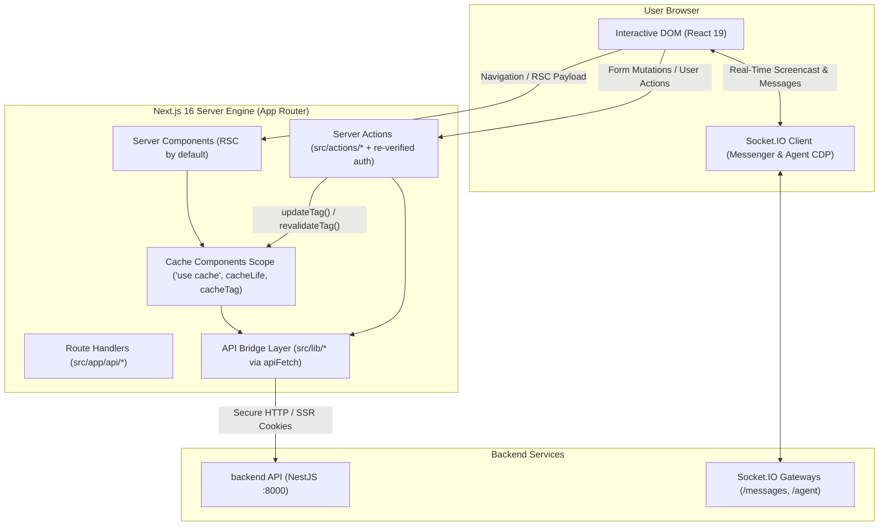

# Chakri.ai — Web Application

<p align="center">
  
  
  
  
  
  
</p>

The official web frontend for [Chakri.ai](https://chakriai.com) — Bangladesh's premier intelligent recruitment and talent platform. Architected on **Next.js 16** with **React 19** and **Tailwind CSS 4**, it delivers instant page loads via Partial Prerendering (PPR), the Next.js 16 Cache Components model, real-time Socket.IO communications, and an interactive interface for the Chakri AI autonomous agent.

---

## Architecture & Rendering Pipeline



---

## Key Features

| Domain | Key Capabilities |
|---|---|
| **Public Portal** | High-conversion landing page, live job search with category filters, Bangla government circular details (stats, eligibility, Teletalk SMS steps, admit card/result notices), private job details at `/jobs/[id]` (key facts strip, employer card with a verified tick or an "Unverified" badge, Save, Share and Apply in the header, AI match score for logged-in seekers (a log-in prompt for guests); every match score — job cards, saved jobs, applications, the dashboard home table, the job-detail ring and the apply popup — comes from `POST /api/jobs/match-scores` through `useMatchScores`, shows "Matching…" while pending, and opens the same AI Match Breakdown popup on click, sticky apply card that becomes a bottom bar on mobile) with one-click applications (popup to apply with the profile CV or a one-off uploaded CV; button turns into "Applied"), company directories, pricing plans, and public seeker profiles. |
| **Authentication** | Multi-channel sign-in: Email + WhatsApp OTP, Google One-Tap/OAuth, LinkedIn OAuth, and password recovery. |
| **Signup Gate & Waitlist** | Follows backend `ENABLED_SIGNUP`: when closed, every Sign Up / Register button becomes "Join Waitlist", `/auth/signup` redirects to `/waitlist`, and the waitlist form collects early-access sign-ups. |
| **Onboarding Engine** | Guided role selection (`SEEKER` or `RECRUITER`), handle reservation, contact validation, and customized profile setup. |
| **Seeker Dashboard** | Job search with advanced filters, application tracker, interactive CV builder, public profile manager, inbox, AI learning chat, and AI interviews (`/dashboard/seeker/ai-interview`). |
| **AI Interview** | Full-screen voice interview at `/interview/[id]`: lobby with interviewer video and voice preview, device check and consent; live room with the speaking interviewer, a question caption that stays until the answer is submitted, live transcript, silence handling (10s warning, then 5s before Zayn moves on) and proctoring (face, phone, tab, fullscreen; 3 warnings end it); report at `/interview/[id]/report` for the seeker and the recruiter. Seekers can reset a completed interview from the list or the report (temporary, until launch). |
| **Recruiter Dashboard** | Job authoring, manual applicant review per job (`/dashboard/recruiter/my-posts/[id]`: view CV and profile, send an AI interview invite or reject), AI candidate search, talent shortlists, company profile management, and team messaging. |
| **Real-Time Messenger** | Low-latency chat between applicants and hiring teams featuring presence detection, typing indicators, read receipts, and interview invite / rejection / completed cards. |
| **Plans and Diamonds** | `/pricing` shows the seeker and recruiter diamond plans; `/dashboard/{seeker,recruiter}/credits` shows the balance, plan cards with SSLCommerz checkout and payment history (a `?payment=` result shows a toast); `/dashboard/{seeker,recruiter}/usage` shows the balance and diamond activity; both navbars show the diamond balance. |
| **Chakri AI Agent** | Autonomous co-pilot with streaming text replies, intent announcements, live browser CDP screencast, interactive approval/question cards, and Gmail integration. |

---

## Tech Stack

| Layer | Tools & Libraries |
|---|---|
| **Framework** | Next.js 16 (App Router, `cacheComponents: true`, Partial Prerendering) |
| **UI Library** | React 19, Lucide React icons |
| **Styling** | Tailwind CSS 4 (`@tailwindcss/turbopack`), modern responsive utilities |
| **Networking & API** | Type-safe `apiFetch` bridge client with automatic SSR cookie forwarding |
| **Real-Time** | `socket.io-client` for `/messages` and `/agent` |
| **Rich Text & Math** | `react-markdown`, `remark-gfm`, `rehype-highlight`, `katex` |
| **Geospatial & Maps** | Leaflet with OpenStreetMap and Geoapify location autocomplete |
| **Code Quality** | TypeScript 5, ESLint 9 (`eslint-config-next`) |

---

## Getting Started

### Prerequisites

- **Node.js**: `v24.x` or higher
- **Backend API**: The [`backend`](../backend) API server running (default: `http://localhost:8000`)

### Installation & Local Development

1. **Clone and install dependencies:**
   ```bash
   git clone https://github.com/chakriaitechlab/chakri-ai-frontend.git
   cd chakri-ai-frontend
   npm install
   ```

2. **Configure environment variables:**
   ```bash
   cp .env.example .env.local
   ```
   Set `NEXT_PUBLIC_API_URL` to your running backend (`http://localhost:8000`).

3. **Start the development server:**
   ```bash
   npm run dev
   ```

4. **Access the application:**
   Open [http://localhost:3000](http://localhost:3000) in your browser.

---

## Available Scripts

| Script | Purpose |
|---|---|
| `npm run dev` | Start the development server with Next.js Turbopack |
| `npm run build` | Compile and optimize the production bundle with PPR analysis |
| `npm run start` | Run the compiled production server locally |
| `npm run lint` | Execute static analysis and Next.js linting checks |
| `npm run deploy` | One-command deployment trigger for Vercel production |

---

## Next.js 16 Architectural Rules

The frontend strictly implements modern Next.js 16 and React 19 architectural principles:

1. **Server Components by Default (RSC):**
   - All `page.tsx` and `layout.tsx` files are Server Components.
   - `'use client'` is pushed strictly to interactive leaf components (buttons, search inputs, dialogs, media players).
2. **Next.js 16 Cache Components Model:**
   - Caching uses the `"use cache"` directive along with `cacheLife()` and `cacheTag()`.
   - Server Actions invalidate caches immediately via `updateTag('jobs')` (read-your-own-writes).
3. **Partial Prerendering (PPR) & Streaming:**
   - Static shells render instantly for optimal TTFB and SEO crawlers. Dynamic widgets stream through React `<Suspense fallback={<Skeleton />}>`.
4. **Mutations & User Feedback:**
   - Forms execute through Server Actions with React 19 `useActionState`.
   - Feedback alerts never shift layout; all mutations display status toasts through the global `@/components/ui/FormAlert`.
5. **Re-verified Action Authorization:**
   - Every Server Action independently re-validates the user session and permission scope.

---

## Project Structure

```
src/
├── app/                            # Route files ONLY (pages, layouts, error, not-found, handlers)
│   ├── (homepage)/                 # Public marketing & informational routes
│   │   ├── jobs/                   # Public job search, private job details, govt circulars (jobs/govt/[id])
│   │   ├── employers/              # Company search and profiles
│   │   ├── candidates/             # Public talent directory
│   │   ├── pricing/                # Diamond plans for job seekers and recruiters
│   │   ├── support/                # Contact and support desk
│   │   └── waitlist/               # Early-access waitlist (only while signup is closed)
│   ├── auth/                       # Sign-in, sign-up, OTP validation, OAuth redirects
│   ├── onboarding/                 # Guided onboarding wizard
│   ├── dashboard/                  # Authenticated application shells
│   │   ├── seeker/                 # Job seeker tools, CV builder, Learn AI, Agent, credits (plans), usage (diamonds)
│   │   └── recruiter/              # Job posting, talent database, analytics, Agent, credits (plans), usage (diamonds)
│   ├── messages/                   # Deep-linked messaging views
│   ├── interview/                  # Full-screen AI interview: lobby, room, report
│   └── api/                        # Route handlers (streaming proxies, Gmail OAuth callbacks)
│
├── components/                     # UI components strictly mirroring route hierarchy
│   ├── auth/                       # Auth form controls and social buttons
│   ├── onboarding/                 # Step headers and multi-step forms
│   ├── dashboard/                  # Dashboard navigation, stats, and shared widgets
│   │   └── agent/                  # Chakri AI agent interface (presence, screencast, cards)
│   ├── interview/                  # AI interview lobby, live room, report, interviewer video
│   └── ui/                         # Design system primitives (FormAlert, AppLoader, modals)
│
├── actions/                        # Next.js Server Actions (one file per domain module)
├── lib/                            # Typed API bridge client calling backend
├── hooks/                          # Custom React hooks (useAgentSession, useMessengerSocket, useMatchScores)
├── types/                          # Strict TypeScript interface and type declarations
├── utils/                          # Shared utilities (session, routes, cookies, formatters)
└── styles/                         # Feature-scoped stylesheets and Tailwind base
```

---

## Environment Variables

| Variable | Required | Description | Default |
|---|---|---|---|
| `NEXT_PUBLIC_API_URL` | **Yes** | Base endpoint of `backend` API | `http://localhost:8000` |
| `NEXT_PUBLIC_SITE_URL` | **Yes** | Canonical origin for OpenGraph and metadata | `http://localhost:3000` |
| `NEXT_PUBLIC_GOOGLE_CLIENT_ID` | Optional | Google Cloud OAuth Client ID for social sign-in | — |
| `NEXT_PUBLIC_LINKEDIN_CLIENT_ID`| Optional | LinkedIn OAuth Client ID for social sign-in | — |
| `NEXT_PUBLIC_GEOAPIFY_API_KEY` | Optional | Office location autocomplete API key | Falls back to OSM |

---

## Deployment

The application is optimized for deployment on **Vercel**:

- **Production Builds:** Configured via `npm run build` using the Next.js 16 engine.
- **Function Region:** `vercel.json` runs server functions in `sin1` (Singapore), next to the Render API and the Supabase database; the default `iad1` adds a cross-world round trip to every server-side API call.
- **Environment Linking:** Ensure `NEXT_PUBLIC_API_URL` points to the production `backend` deployment (e.g. on Render).
- **OAuth Callback:** Add your production domain callback (`https://yourdomain.com/api/agent/connectors/gmail/callback`) to the authorized redirect URIs in Google Cloud Console.
